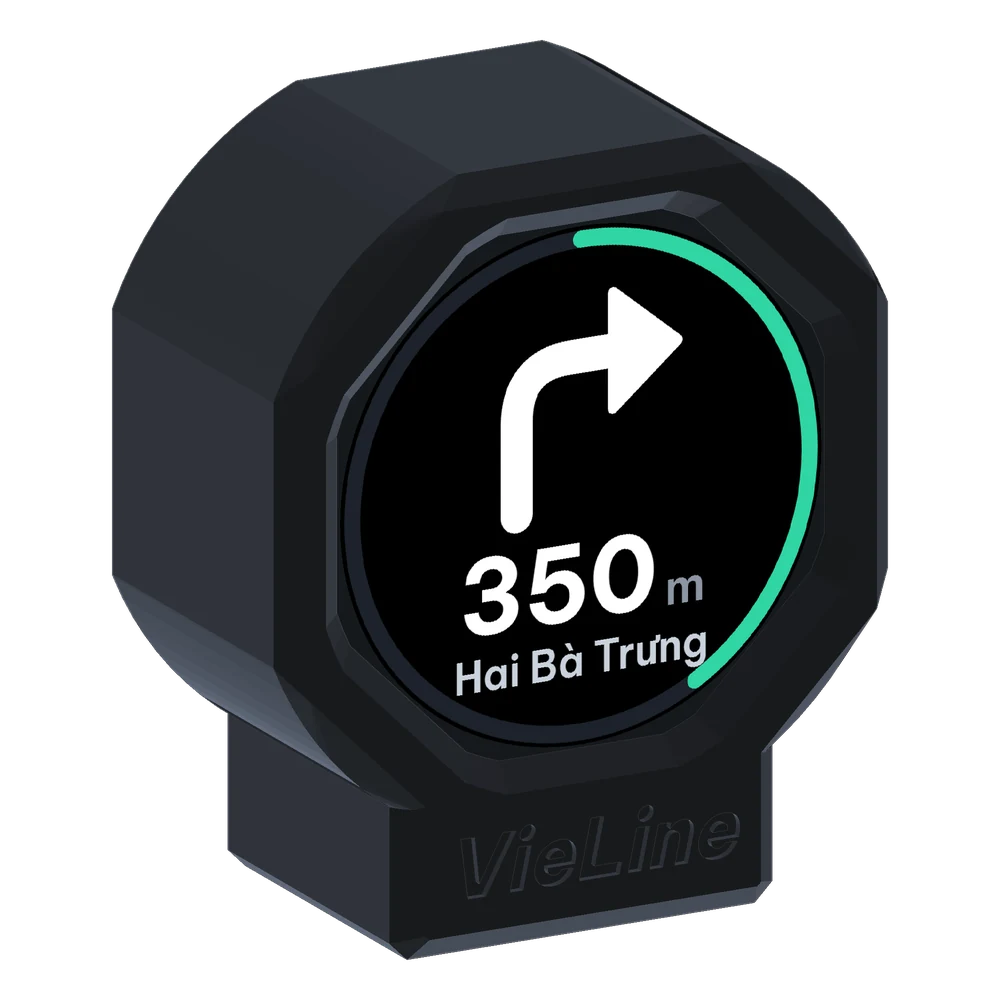
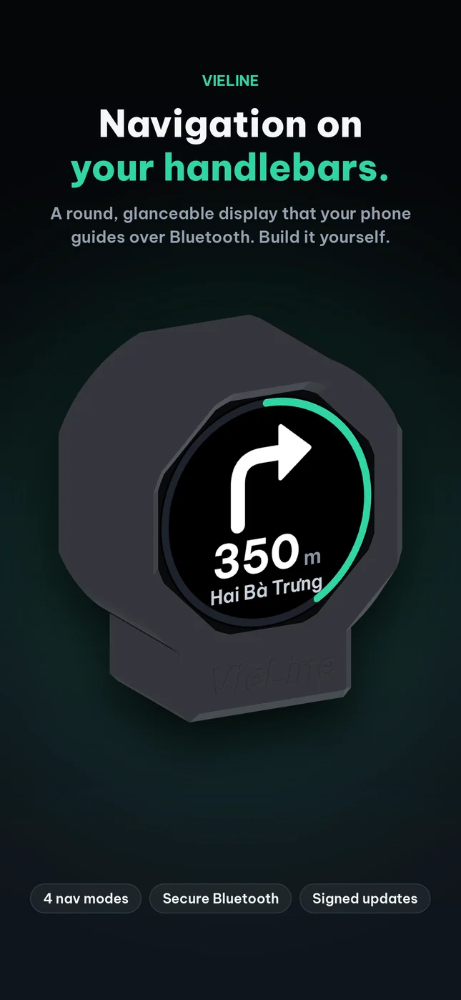
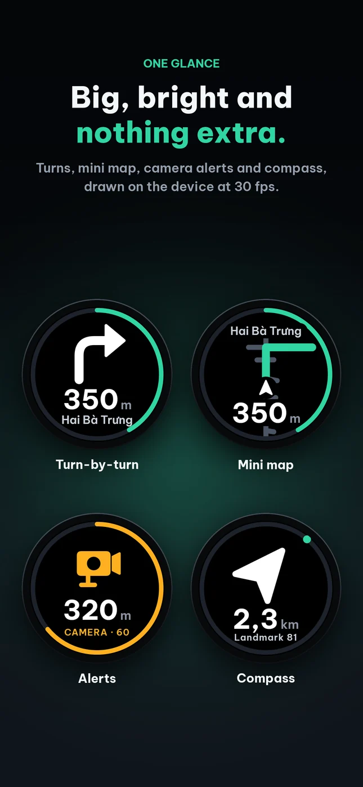
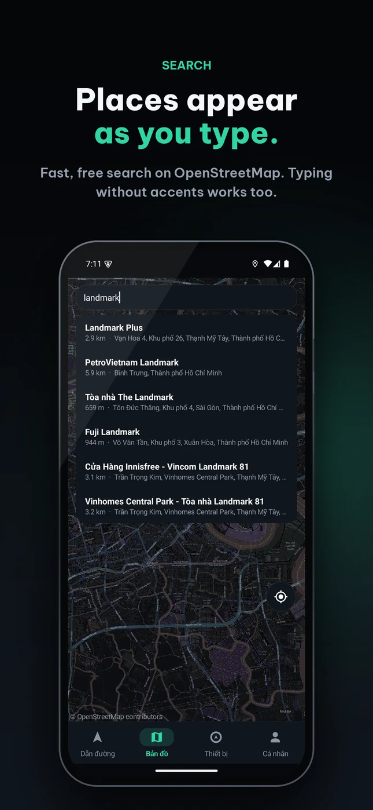
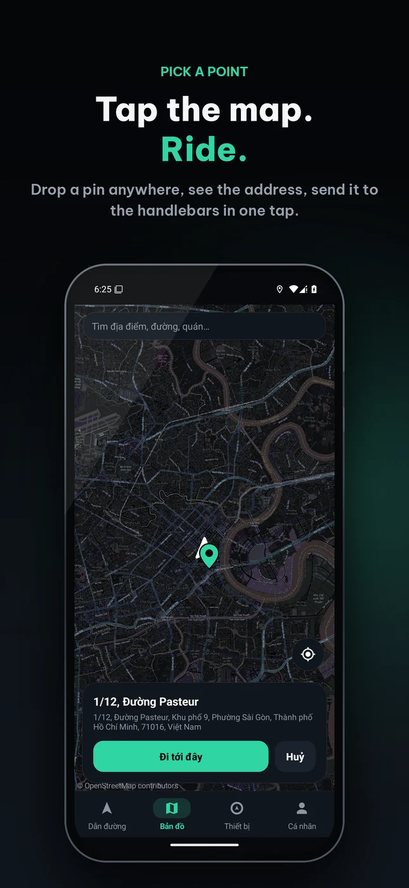
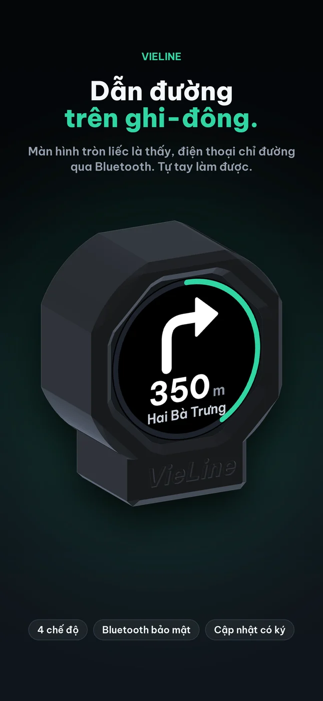
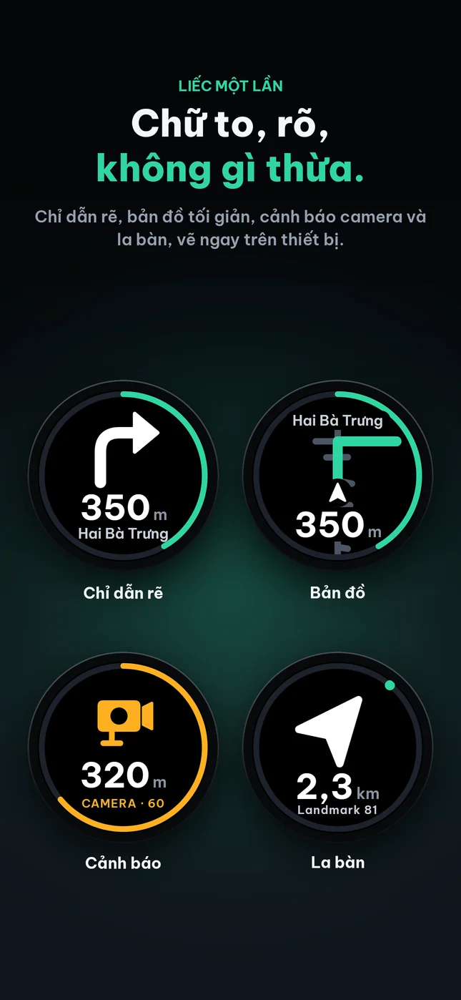
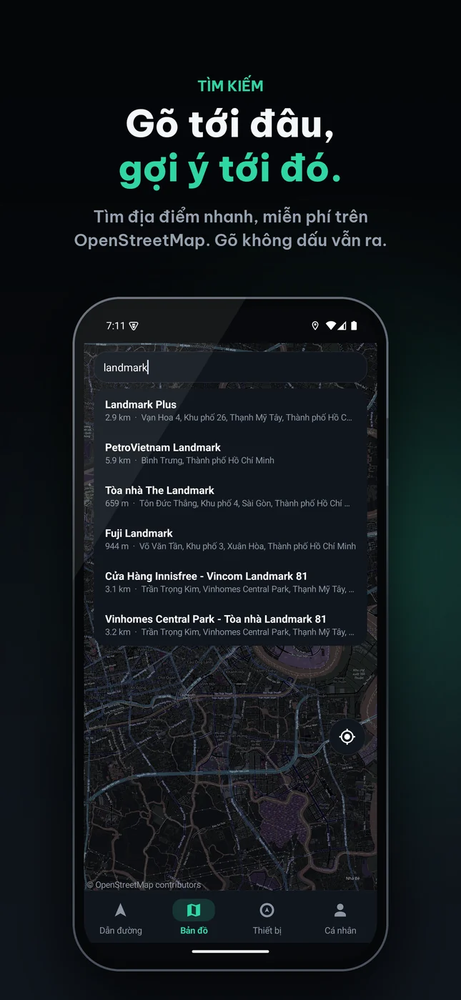
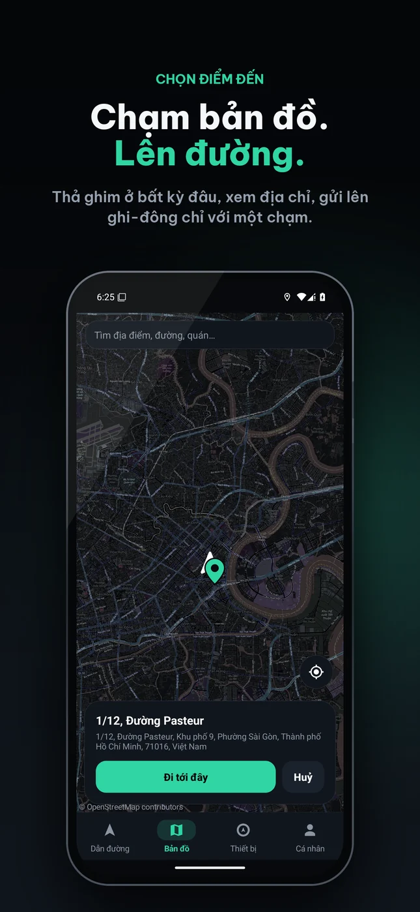

  

<h1 align="center">VieLine</h1>

  <b>Handlebar navigation you build yourself.</b> 
  <i>Thiết bị dẫn đường gắn ghi-đông xe máy, tự làm.</i>

  <a href="https://h2n07.github.io/VieLine/">Website</a> ·
  <a href="https://h2n07.github.io/VieLine/flash/">Web flasher</a> ·
  <a href="https://github.com/h2n07/VieLine/releases/latest">Download</a> ·
  <a href="hardware/">Hardware</a>

---

**English** · [Tiếng Việt](#tiếng-việt)

VieLine is a round 1.28″ turn-by-turn display for motorbikes. Your Android phone stays in your pocket, works out the route, and sends the next instruction to the handlebars over encrypted Bluetooth LE.

- **Four navigation modes:** VieLine map (Valhalla on OpenStreetMap, with a mini map), Google Maps, Waze, and an offline compass.
- **Easy to build:** 12 parts from one shop, through-hole only, a soldering iron is all you need. Screwless, single-colour 3D-printed case with GoPro or Garmin twist-lock mounts.
- **Secure:** LE Secure Connections pairing with a passkey, ECDSA P-256 signed OTA updates with anti-downgrade and automatic rollback.

     

> **Status:** public preview v0.2.0. The firmware builds and the app runs on Android; validation on real hardware is in progress. Please report anything you find in [Issues](https://github.com/h2n07/VieLine/issues).

### What's in this repository
| Path | Contents |
|---|---|
| [`hardware/`](hardware/) | BOM, wiring diagram, STL print files, renders and assembly notes |
| [`flash/`](flash/) | Browser flasher (ESP Web Tools) and the full firmware image |
| [Releases](https://github.com/h2n07/VieLine/releases) | Android app (APK), signed OTA update, complete offline package |
| `index.html`, `assets/` | The project website |

This repository holds **releases and hardware documentation only**. VieLine is not open source; the firmware and app source code is not published.

### Licence
- Firmware and app: free for personal, non-commercial use, see [LICENSE.md](LICENSE.md).
- Hardware documentation: [CC BY-NC-SA 4.0](https://creativecommons.org/licenses/by-nc-sa/4.0/).
- Third-party components: [THIRD_PARTY_NOTICES.md](THIRD_PARTY_NOTICES.md).

Not affiliated with Beeline, Google or Waze.

---

## Tiếng Việt

VieLine là màn hình dẫn đường tròn 1.28″ gắn ghi-đông xe máy. Điện thoại Android nằm trong túi lo phần tìm đường, rồi gửi chỉ dẫn tiếp theo lên ghi-đông qua Bluetooth LE có mã hoá.

- **Bốn chế độ dẫn đường:** bản đồ VieLine (Valhalla trên OpenStreetMap, có bản đồ tối giản), Google Maps, Waze, và la bàn không cần mạng.
- **Dễ làm:** 12 linh kiện mua ở một cửa hàng, toàn loại chân cắm, chỉ cần mỏ hàn thường. Vỏ in 3D một màu, không ốc vít, ngàm GoPro hoặc Garmin xoay khoá.
- **Bảo mật:** ghép đôi LE Secure Connections bằng mã, cập nhật OTA có chữ ký ECDSA P-256, chống hạ cấp và tự quay về bản cũ khi lỗi.

     

> **Trạng thái:** bản xem trước v0.2.0. Firmware đã build xong, app đã chạy trên Android; đang thử trên phần cứng thật. Gặp lỗi hãy báo ở [Issues](https://github.com/h2n07/VieLine/issues).

### Trong kho này có gì
| Đường dẫn | Nội dung |
|---|---|
| [`hardware/`](hardware/) | BOM, sơ đồ đấu nối, file in STL, ảnh và ghi chú lắp ráp |
| [`flash/`](flash/) | Trang nạp firmware trên trình duyệt và tệp firmware đầy đủ |
| [Releases](https://github.com/h2n07/VieLine/releases) | App Android (APK), bản cập nhật OTA có chữ ký, gói đầy đủ dùng ngoại tuyến |
| `index.html`, `assets/` | Trang giới thiệu dự án |

Kho này **chỉ chứa bản phát hành và tài liệu phần cứng**. VieLine không phải mã nguồn mở; mã nguồn firmware và app không được công bố.

### Giấy phép
- Firmware và app: miễn phí cho cá nhân, phi thương mại, xem [LICENSE.md](LICENSE.md).
- Tài liệu phần cứng: [CC BY-NC-SA 4.0](https://creativecommons.org/licenses/by-nc-sa/4.0/deed.vi).
- Thành phần bên thứ ba: [THIRD_PARTY_NOTICES.md](THIRD_PARTY_NOTICES.md).

Không liên quan tới Beeline, Google hay Waze.
