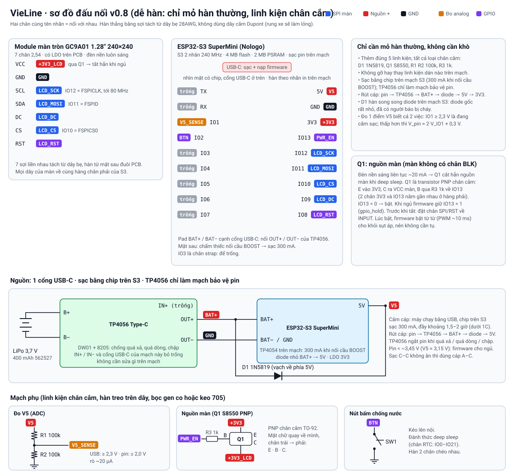

# Phần cứng prototype v0.8: dễ hàn, chỉ cần mỏ hàn thường, linh kiện mua hết ở Điện tử Tuyết Nga

Vỏ in 3D và cách lắp ráp nằm ở [`enclosure/`](enclosure/README.md).

**Điện tử Tuyết Nga**: 31/2 Nguyễn Văn Bảo, Gò Vấp, ĐT 0936 832 336; chi nhánh 52 Hữu Nghị, Thủ Đức, ĐT 0708 787 899.

## BOM: 12 món, mua đúng món này thì vỏ in ra mới khớp

| # | Linh kiện | SL |
|---|---|---|
| 1 | [Màn Hình LCD TFT 1.28 Inch IPS GC9A01 SPI](https://dientutuyetnga.com/products/man-hinh-lcd-tft-1-28-inch-ips-gc9a01-spi) | 1 |
| 2 | [Kit Phát Triển Wifi Bluetooth ESP32-S3 Super Mini (bản nâng cấp)](https://dientutuyetnga.com/products/kit-phat-trien-wifi-bluetooth-esp32-s3-super-mini-ban-nang-cap) (hãng Nologo, chip ESP32-S3**FH4R2**, có chip sạc pin) | 1 |
| 3 | [Mạch Sạc TP4056 Cổng TypeC](https://dientutuyetnga.com/products/mach-sac-tp4056-cong-typec) (chỉ dùng làm mạch bảo vệ pin; ảnh shop ghi 28 × 17,3 mm, mô tả ghi 26 × 17 mm, vỏ làm theo số lớn) | 1 |
| 4 | [Pin Lipo 400mAh 562527](https://dientutuyetnga.com/products/pin-lipo-400mah-562527) (27 × 25 × 5,6 mm) | 1 |
| 5 | [Nút Nhấn 4 Chân 6x6x7mm Chống Nước](https://dientutuyetnga.com/products/nut-nhan-4-chan-6x6x7mm-chong-nuoc) | 1 |
| 6 | [1N5819 Diode Schottky 1A 40V](https://dientutuyetnga.com/products/1n5819-diode-schottky-5819-1a-40v) (D1, chân cắm DO-41) | 1 |
| 7 | [S8550 Transistor PNP TO-92](https://dientutuyetnga.com/products/s8550-transistor-8550-pnp-to-92) (Q1, chân cắm) | 1 |
| 8 | [Điện Trở 100K 1/4W](https://dientutuyetnga.com/products/dien-tro-100k-1-4w) (bịch ~40, dùng 2: R1 R2) | 1 bịch |
| 9 | [Điện Trở 1K 1/4W](https://dientutuyetnga.com/products/dien-tro-1k-1-4w) (bịch ~40, dùng 1: R3) | 1 bịch |
| 10 | [Dây Bẹ Xám Ribbon 10 Sợi 1.27mm](https://dientutuyetnga.com/products/day-be-xam-ribbon-10-soi-1-27mm-300v) (28AWG, tách sợi ra dùng) | 1 mét |
| 11 | [Keo Bảo Vệ Mạch 705 Silicone Trong Suốt](https://dientutuyetnga.com/products/keo-bao-ve-mach-705-silicone-trong-suot) | 1 |
| 12 | [Tấm Silicon Thermal Pad 40x40mm](https://dientutuyetnga.com/products/tam-silicon-tan-nhiet-dem-thermal-pad-40x40mm) (loại **keo 2 mặt, dày 1 mm**) | 2 |

- **Chỉ cần mỏ hàn thường, không cần máy khò.** Ngoài 4 mạch chính (màn, S3, TP4056, pin) chỉ có 5 linh kiện phụ, tất cả loại **chân cắm**: D1, Q1, R1, R2, R3. Không phải gỡ hay thay linh kiện dán nào trên các mạch mua về.
- **Thân máy không có ốc vít.** Nắp sau cài ngàm. Linh kiện được kẹp giữa các chi tiết in và dán bằng tấm silicone 2 mặt. Keo 705 dùng để kín nước.
- **Gắn xe bằng ngàm GoPro:** chi tiết in `ngam_gopro` cắm vào ổ ở lưng thiết bị, xoay 90° là khoá. Đầu kia là 2 chấu GoPro tiêu chuẩn, nên bắt được vào mọi đế GoPro. Ốc duy nhất là ốc vặn tay đi kèm đế GoPro.
- Tấm silicone (mục 12): tấm thứ nhất dán ESP32-S3 + TP4056 lên lưng pin; tấm thứ hai cắt 1 miếng tròn Ø24 dán vào trần ổ xoay (đẩy tai xoay áp chặt, không rung lắc). Phần còn lại để dự phòng.
- **Mua ngoài Tuyết Nga (2 món):**
  - khoảng **18 g nhựa PETG, 1 màu** (đen hoặc xám đậm; shop nhựa in 3D, hoặc đặt tiệm in). Tuyết Nga chỉ bán PLA, mà PLA mềm ra ở khoảng 55 °C khi đậu xe ngoài nắng;
  - **đế kẹp ghi-đông ngàm GoPro** (đầu 3 chấu, có kèm ốc vặn tay), loại cho camera hành trình, có trên Shopee hoặc ở tiệm phụ kiện xe máy. Ống ghi-đông XSR155 Ø22,2. Nếu đã có sẵn đế GoPro trên xe thì dùng luôn.
- Nên có thêm (nếu chưa có): vài đoạn **gen co nhiệt** nhỏ để bọc các mối hàn treo, thay cho keo 705.

**Đừng đổi sang món khác:**
- ESP32-S3 SuperMini bản thường có cùng ảnh và cùng chip, nhưng không ghi hãng. Bản Nologo ổn định hơn (lỗi hàn ngược anten đã gặp ở hàng trôi nổi). Nếu mua bản thường thì phải kiểm tra có pad **BAT** cạnh cổng USB-C.
- Không mua ESP32-S3 bản "hàn chân": hàng chân sẽ cấn vào nắp.
- TP4056 của icdayroi ghi 25 × 19 mm: góc mạch sẽ chạm thành vỏ.
- Pin 503035 (35 × 30) không lọt khoang.

Vỏ được làm theo đúng kích thước các món trên. Đổi sang món khác thì vỏ có thể không khớp.

## Vì sao đổi từ ESP32-C3 sang ESP32-S3
| | ESP32-C3 SuperMini (v0.5) | ESP32-S3 SuperMini (từ v0.6) |
|---|---|---|
| CPU | 1 nhân RISC-V 160 MHz | **2 nhân Xtensa 240 MHz**: BLE chạy 1 nhân, vẽ màn (LVGL) chạy nhân kia |
| RAM | 400 KB | **512 KB + 2 MB PSRAM**: bộ đệm hình lớn hơn, bản đồ, đệm OTA |
| Flash | 4 MB | 4 MB (không đổi) |
| Sạc pin | không | có sẵn (TP4054, 100 mA, 300 mA khi nối cầu BOOST), **không** bảo vệ pin |
| Kích thước | 22,52 × 18 mm, 8 chân mỗi bên | 9 chân mỗi bên; vỏ tính theo 23,5 × 18 mm (nguồn ngoài, nhiều shop chép số của C3) |

- Màn bản đồ (chế độ Valhalla) là phần nặng nhất: vẽ nét đường dày có khử răng cưa. Với S3, khả năng giữ 30 khung/giây cao hơn nhiều. Vẫn phải đo khi làm firmware.
- **Flash vẫn 4 MB**, nên chỗ cho OTA không rộng hơn. Ước tính firmware khoảng 1,3–1,5 MB, mỗi phân vùng OTA khoảng 1,9 MB, còn dư khoảng 25%. Nén icon (LVGL có sẵn) gỡ thêm được khoảng 200 KB. Mạch S3 có 8–16 MB mà vẫn nhỏ như Seeed XIAO ESP32S3 thì Tuyết Nga và icdayroi không bán.

## Những điều cần biết về màn
Bản vẽ của shop cho thấy module có **7 chân** (VCC, GND, SCL, SDA, DC, CS, RST), **không có chân BLK**. Tuyết Nga chỉ bán đúng mẫu này. Kích thước:
- PCB tròn Ø38 có đuôi nhô xuống, tổng cao 45,5 mm, đuôi rộng 22,92 mm.
- 2 lỗ Ø2 cách nhau 19,26 mm.
- Bề dày: kính 1,5 + PCB 1,6 + linh kiện dán phía sau tối đa 1,2 mm.

Hệ quả của việc không có chân BLK:
- **Không chỉnh được độ sáng**: đèn nền luôn ở mức tối đa (shop ghi 400 cd/m²). Như vậy tốt khi chạy ngoài nắng. Ban đêm firmware sẽ dùng bảng màu tối hơn để đỡ chói.
- **Đèn nền tốn khoảng 20 mA liên tục**, nên màn được cấp nguồn qua **Q1** (S8550, transistor PNP chân cắm):
  - E (emitter) vào chân 3V3, C (collector) ra chân VCC của màn, B (base) qua R3 1k về IO13;
  - IO13 = 0 thì màn bật; khi ngủ, firmware giữ IO13 = 1 bằng `gpio_hold_en` + `gpio_deep_sleep_hold_en`, Q1 cắt hẳn nguồn;
  - trước khi tắt Q1, firmware đặt các chân SPI/RST về INPUT, để dòng không chạy ngược qua chân tín hiệu nuôi màn;
  - lúc bật, firmware bật Q1 từ từ (PWM tăng dần khoảng 10 ms) để tụ trên mạch màn nạp dần, không làm sụt 3V3. Nhờ vậy bỏ được tụ C1. Nếu thử thấy S3 bị khởi động lại đúng lúc bật màn thì hàn thêm 1 tụ hoá 47 µF giữa 3V3 và GND.
  - S8550 sụt khoảng 0,1–0,2 V ở 25 mA, màn vẫn chạy bình thường vì nó chịu được 2,8–3,3 V.

## Bảng chân (ESP32-S3 SuperMini, nhìn mặt có chip, cổng USB-C ở trên)
Hàng phải từ trên xuống: 5V, GND, 3V3, 13, 12, 11, 10, 9, 8. Hàng trái: TX, RX, 1, 2, 3, 4, 5, 6, 7. Hàn theo nhãn in trên mạch.

| Chân | Nối tới | Ghi chú |
|---|---|---|
| IO12 | Màn **SCL** | FSPICLK qua IO_MUX, chạy được tới 80 MHz |
| IO11 | Màn **SDA** (MOSI) | FSPID |
| IO10 | Màn **CS** | FSPICS0 |
| IO9 | Màn **DC** | |
| IO8 | Màn **RST** | |
| IO13 | **PWR_EN** → R3 1k → chân B của Q1 | Mức 0 = bật nguồn màn |
| IO1 | **V5_SENSE** (ADC1_CH0) | Chia áp R1/R2 100k/100k từ chân 5V |
| IO2 | **Nút bấm** xuống GND | Kéo lên nội. Là chân RTC nên đánh thức được S3 khỏi deep sleep |
| 5V | **V5** | USB 5V khi cắm cáp; pin qua diode khi rút cáp |
| 3V3 | Chân E của Q1 | |
| BAT+ / BAT− | **OUT+ / OUT−** của TP4056 | Pad cạnh cổng USB-C. Pin hàn vào B+/B− của TP4056, không hàn thẳng vào S3 |
| TX, RX, IO3–IO7 | để trống | IO3 là chân strap. TX/RX để xem log khi cần |

Mọi dây của màn về cùng hàng chân phải, nên dải 7 sợi dây bẹ đi thẳng một đường.

## Nguồn: một cổng USB-C, sạc bằng chip trên S3, TP4056 chỉ làm mạch bảo vệ pin
- **Cổng USB-C của ESP32-S3** là cổng duy nhất lộ ra ngoài (ở đáy cằm). Nó vừa sạc pin, vừa nạp firmware, vừa xem log.
- **Cách nối:**
  - pin → B+/B− của TP4056;
  - OUT+/OUT− của TP4056 → pad BAT+/BAT− của S3, nên mọi thứ phía sau đều đi qua mạch bảo vệ DW01 + 8205 của TP4056 (ngắt khi pin xả quá sâu, quá dòng hoặc bị chập);
  - **IN+/IN− và cổng USB-C của TP4056 bỏ trống.** Không cần thay điện trở R_PROG, vì chip sạc của TP4056 không được dùng.
  - Đất của cả mạch là OUT−, **không phải B−**.
- **Sạc:** chip sạc TP4054 trên mạch S3 lo việc sạc, ngắt ở 4,2 V.
  - Mặc định 100 mA: sạc đầy khoảng 4,5 giờ.
  - **Nên chấm 1 giọt thiếc nối cầu BOOST** ở mặt sau mạch S3 (2 pad nhỏ cạnh nhau, chỉ cần mỏ hàn): sạc 300 mA, đầy khoảng 1,5–2 giờ. 300 mA là 0,75C với pin 400 mAh, vẫn dưới mức 1C.
  - Nhà sản xuất khuyên cầu BOOST cho pin trên 500 mAh. Ở đây pin có TP4056 bảo vệ thêm, và chip tự giảm dòng khi nóng, nên dùng được. Nếu mạch không có cầu BOOST thì sạc 100 mA.
- **Rút cáp:** pin → TP4056 → BAT+ → diode → chân 5V → LDO 3V3. Khi pin còn khoảng 3,45 V (V5 ≈ 3,15 V), firmware cho thiết bị ngủ, vì thấp hơn nữa LDO không giữ được 3,3 V.
- **D1 (1N5819) hàn song song với diode trên mạch S3**, từ pad BAT+ tới chân 5V. Vạch trắng trên thân D1 quay về phía chân 5V. Lý do: diode gốc rất nhỏ, và có người dùng báo nó bị cháy khi vừa cắm pin vừa nạp code. Khi đó máy vẫn chạy bằng USB nhưng rút cáp là tắt. 1N5819 chịu 1 A, sụt áp thấp, nên dòng đi qua nó.
- **Nạp firmware qua cáp lúc pin đang nối vẫn an toàn**, vì các diode chặn 5V đi thẳng vào pin.
- **Đo pin và phát hiện cắm sạc bằng 1 chân ADC:** R1/R2 chia đôi điện áp chân 5V. Đọc ≥ 2,3 V là đang cắm sạc. Nhỏ hơn thì V_pin ≈ 2 × V_adc + 0,3 V (sai số khoảng ±5% dung lượng, đủ cho thanh pin). Lúc đang sạc màn hiện "đang sạc", không hiện %.
- Một số bộ sạc USB-C không cấp điện khi dùng cáp C–C cho mạch giá rẻ. Gặp trường hợp đó thì dùng cáp A–C.

| Tải | Dòng |
|---|---|
| ESP32-S3 (BLE + LVGL 30 fps, CPU 160 MHz, tự hạ xung khi rảnh) | ước tính 50–70 mA |
| Màn (đèn nền luôn sáng) | ~20 mA |
| **Tổng khi chạy** | **~70–90 mA → khoảng 4,5–5,5 giờ với pin 400 mAh** (cần đo thực tế) |
| Deep sleep (Q1 tắt) | mạch S3 khoảng 43 µA (theo nguồn ngoài) + cầu chia R1/R2 ~20 µA + DW01 vài µA → khoảng 70 µA, pin đầy để được vài tháng |

Đi làm hằng ngày ở TP.HCM thì 2–3 ngày sạc một lần. Đi xa thì cắm sạc dự phòng: thiết bị vẫn chạy bình thường trong lúc sạc.

**Anten BLE:** anten gốm của S3 nằm ở đầu mạch đối diện cổng USB-C, tức là sau lưng pin, cạnh TP4056. Với điện thoại trong túi cách khoảng 1 m thì thường vẫn đủ, nhưng phải thử ngay khi nhận mạch. Nếu sóng yếu: hàn một sợi dây đồng 31 mm vào chân anten, dán dọc thành trong bên hông vỏ.

## Kiểm tra ngay khi nhận hàng
1. **Pin:** đã có TP4056 bảo vệ, nhưng pin có thêm mạch bảo vệ riêng (mảnh mạch nhỏ dưới băng keo) thì càng tốt.
2. **Mạch S3:** có pad BAT cạnh cổng USB-C; xem mặt sau có cầu BOOST không; anten gốm hàn đúng chiều (so với ảnh trên trang shop). Cắm USB, nạp sketch quét BLE, đứng cách điện thoại 2–3 m vẫn thấy tín hiệu.
3. **Đo bằng thước kẹp:** chiều dài mạch S3 (từ mép đối diện tới miệng cổng USB-C) và kích thước TP4056. Khác nhiều so với số ghi ở đây thì mở issue trên GitHub kèm số đo.

## Kiểm tra trước khi đóng nắp
1. **Chưa nối pin.** Cắm cáp vào cổng USB-C của S3: chân 5V ≈ 5 V, chân 3V3 ≈ 3,3 V, IO1 ≈ 2,5 V.
2. Hàn pin vào B+/B− của TP4056 (OUT+/OUT− đã nối sang BAT+/BAT− của S3), rút cáp: chân 5V ≈ V_pin − 0,3 V, chân 3V3 ≈ 3,3 V.
3. Nối IO13 xuống GND: chân VCC của màn phải có khoảng 3,1–3,2 V, đèn nền sáng. Bỏ ra thì về gần 0 V.
4. Cắm cáp lại: đèn sạc xanh dương trên S3 sáng khi đang sạc, tắt khi đầy.
5. Nạp sketch thử màn qua cáp (pin vẫn nối): màn phải hiện hình, `Serial` in được log. Rút cáp: máy vẫn chạy bằng pin (nếu tắt là đường pin có vấn đề, kiểm tra D1 và dây OUT+ → BAT+).
6. Lắc nhẹ cả cụm khi màn đang chạy: hình không được nháy hay mất.
