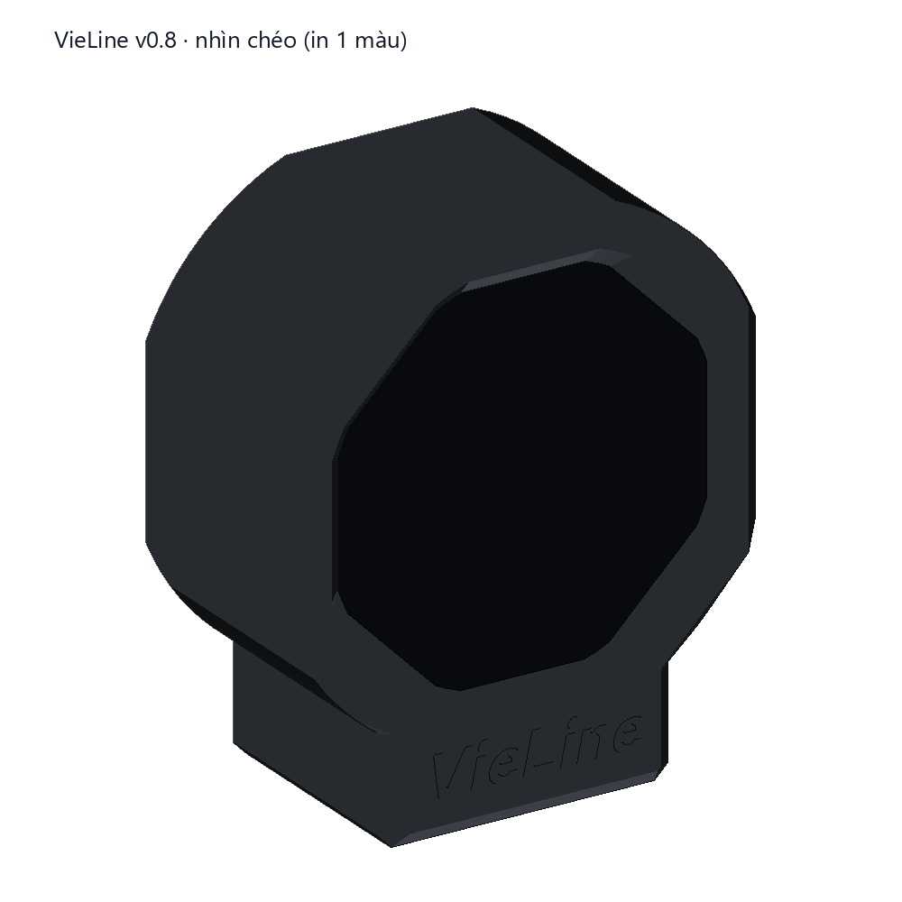
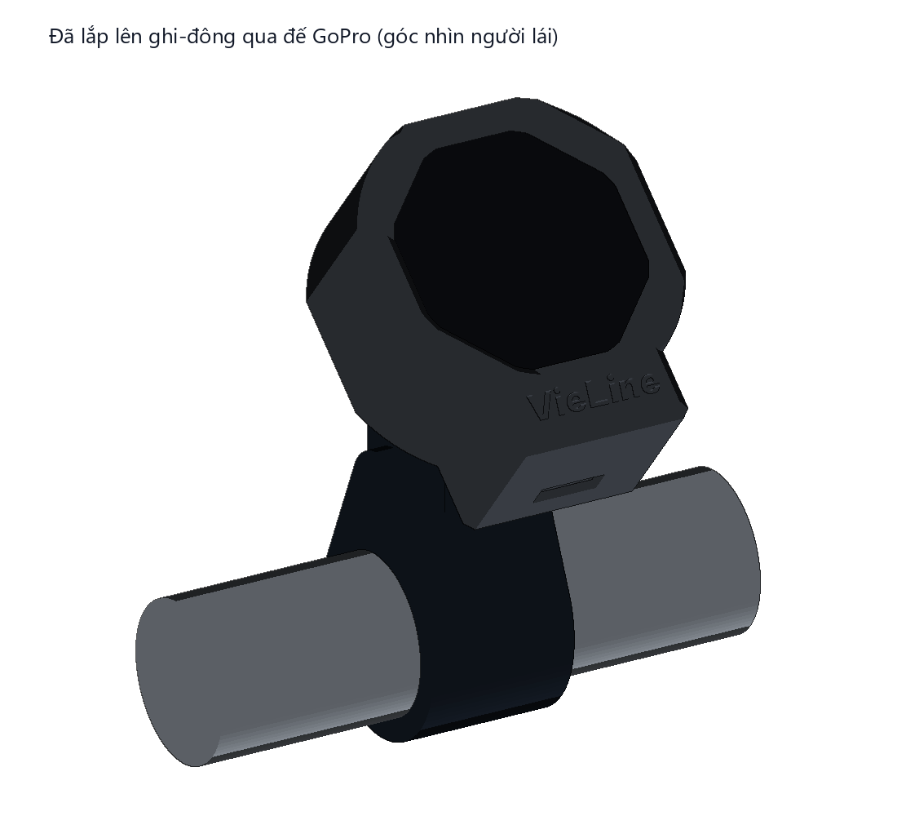
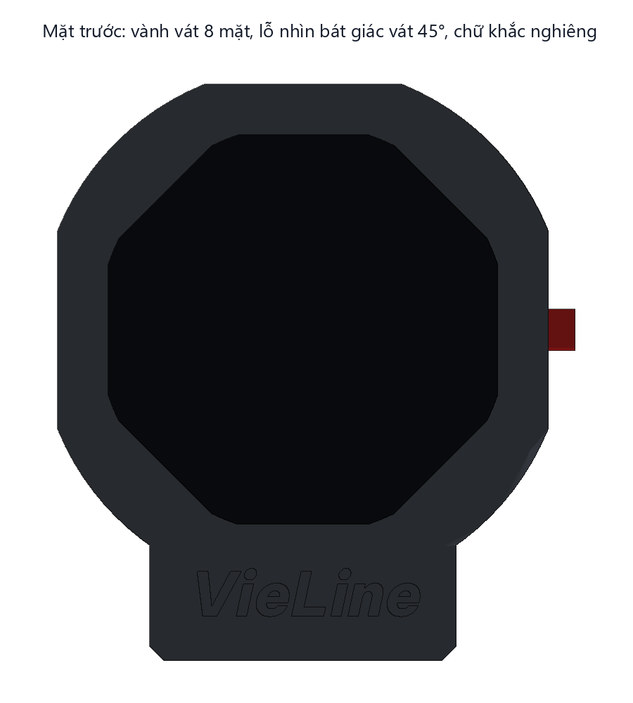
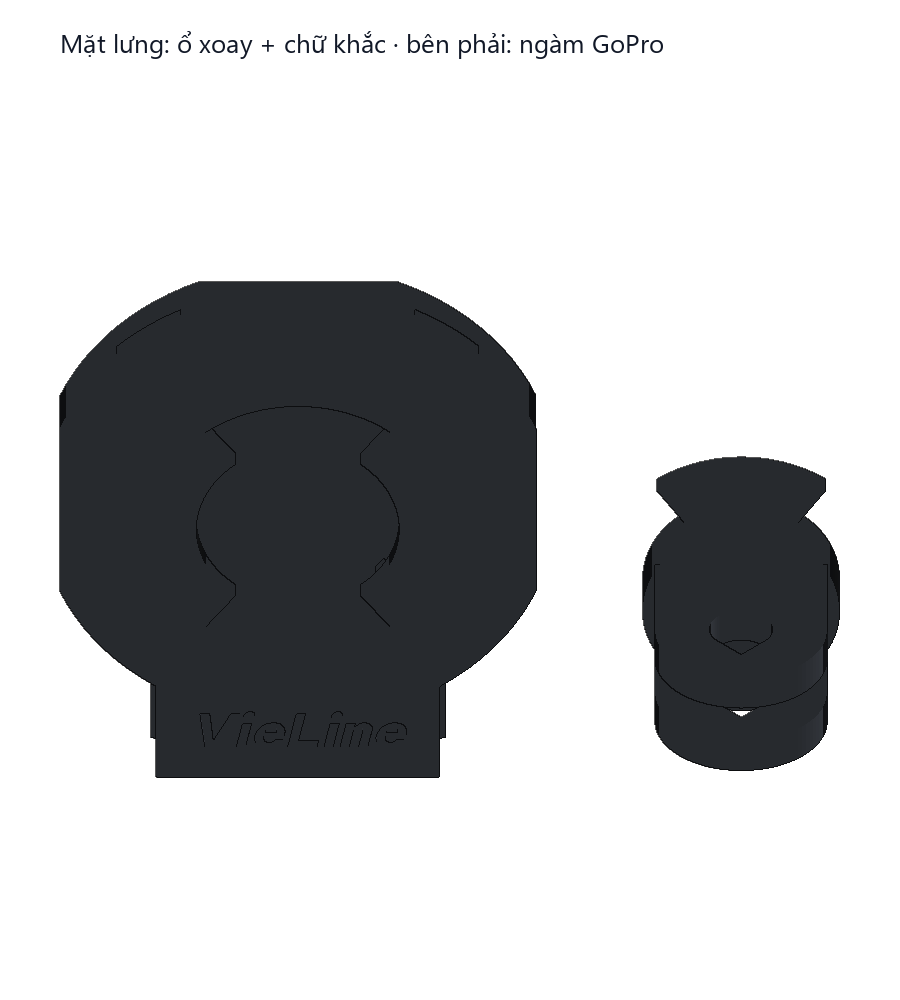
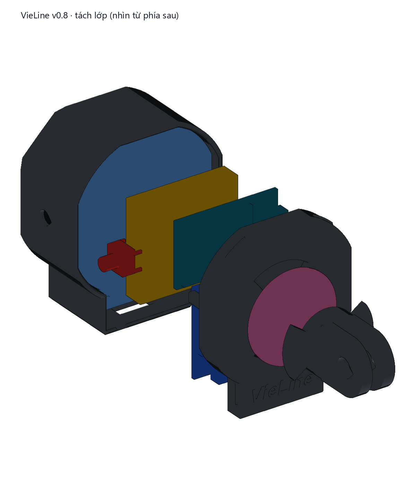
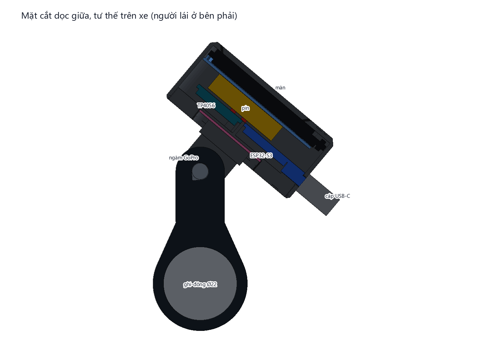
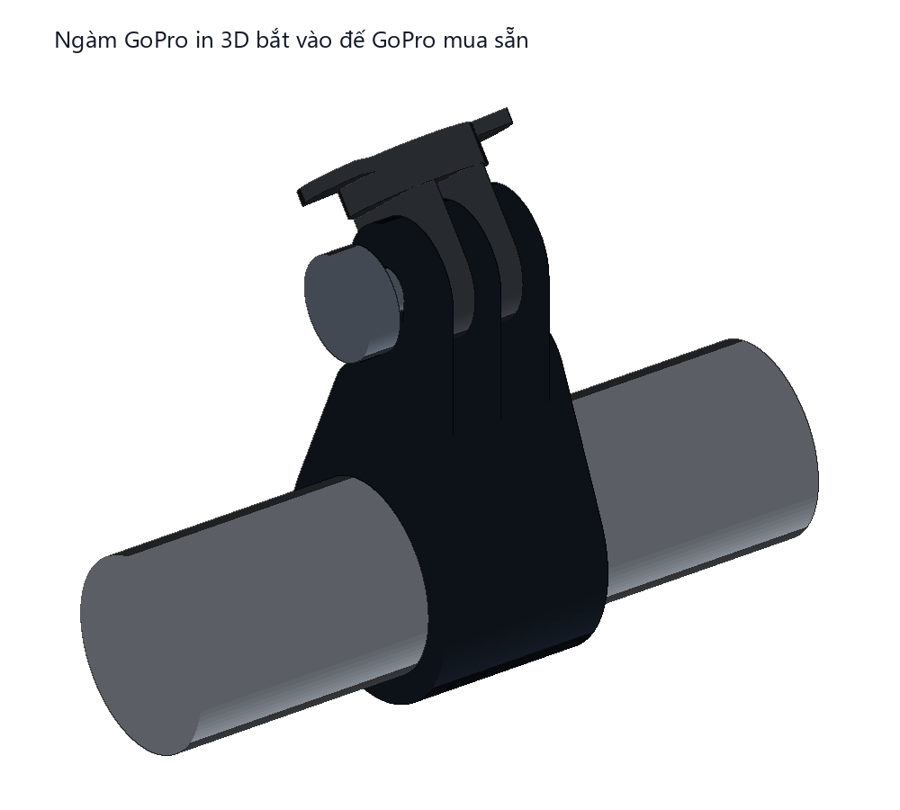
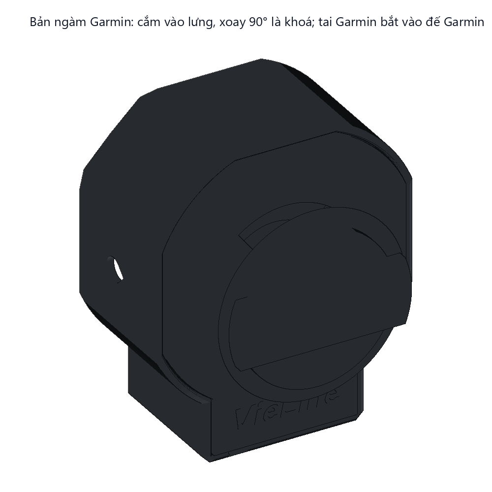

# Vỏ in 3D v0.8: thân tròn, mặt trước góc cạnh, in 1 màu, gắn xe bằng ngàm GoPro hoặc Garmin xoay 1/4 vòng

| Nhìn chéo | Đã lắp lên ghi-đông |
|---|---|
|  |  |

| Mặt trước | Mặt lưng: ổ xoay + chữ khắc |
|---|---|
|  |  |

| Tách lớp | Mặt cắt dọc (tư thế trên xe) |
|---|---|
|  |  |

| Ngàm GoPro + đế GoPro mua sẵn | Bản ngàm Garmin |
|---|---|
|  |  |

- **Kích thước thân:** 41,4 × 48,6 × 22,9 mm (rộng × cao × dày).
- **Thân tròn, chỉ mặt trước góc cạnh, in 1 màu, không sơn:**
  - thân tròn ở 4 góc, chỉ phẳng nhẹ ở mặt trên và 2 hông (giữ bề ngang 41,4 mm); cằm vuông vát 2 góc đáy;
  - **vành trước vát thành 8 mặt phẳng** như mặt đá mài, chuyển dần từ mặt trước bát giác sang thân tròn;
  - **lỗ nhìn bát giác vát 45° sâu hết 1,6 mm mặt trước**, che bớt nắng chiếu xiên vào màn;
  - **chữ VieLine nghiêng 12°** khắc lõm 0,5 mm ở cằm (font Be Vietnam Pro ExtraBold, cùng font với giao diện); chữ nhỏ khắc ở mặt lưng;
  - mép lưng bo vát 0,8 mm.
- **Viền màn:** 4,5 mm ở mặt trên/hông, 6,1 mm ở các góc tròn. Lỗ nhìn bát giác ôm sát vùng hiển thị tròn Ø32,4: 8 cạnh tiếp xúc mép vùng hiển thị, 8 góc nằm trên viền đen sẵn có của kính, nên không lộ mép PCB.
- **Mạch ESP32-S3 nằm dọc theo cằm,** cổng USB-C ở đáy cằm, cùng hướng với đuôi màn. Miệng cổng nằm ngang mặt ngoài vỏ nên đầu cáp cắm hết cỡ. **TP4056** (mạch sạc có bảo vệ pin) nằm ngay phía trên, góc mạch lọt vào phần tròn của lòng vỏ.
- **Nút bấm** giữa mặt hông phải (3 giờ). Thân nút tì vào mặt phẳng, chắc hơn tì vào mặt cong.
- **Thân máy không có ốc vít:**
  - nắp sau (cũng bát giác) cài ngàm vào vỏ trước (4 vấu);
  - linh kiện được kẹp giữa các chi tiết in, dán bằng tấm silicone 2 mặt;
  - keo 705 dùng để kín nước.
- **Gắn xe kiểu Beeline: cắm vào, xoay 90° là khoá.**
  - Lưng nắp có một ổ xoay kín, không thủng vào trong máy.
  - Chi tiết in `ngam_gopro` có 2 tai xoay ở một đầu, và 2 chấu GoPro tiêu chuẩn ở đầu kia. Nó bắt vào **mọi đế GoPro** (kẹp ghi-đông, chân gương, ...) bằng ốc vặn tay đi kèm đế. Đây là con ốc duy nhất, chỉ vặn một lần khi lắp đế.
  - Khớp GoPro chỉnh được góc ngẩng của màn cho hợp tầm mắt.
  - Ở vị trí khoá, mép trước tai chạm vào chặn, còn mép sau đã vượt qua một gờ khấc nên không tự xoay ngược được.
  - Miếng silicone Ø24 dán ở trần ổ luôn đẩy tai áp chặt vào vành, nên thiết bị không rung lắc. Miếng này cũng bù được sai số khi in.
  - Khi đỗ xe: ấn nhẹ thiết bị vào, xoay ngược 90° rồi nhấc ra mang theo.
- **Hai bản ngàm, chọn 1 (hoặc in cả 2):**
  - `ngam_gopro`: 2 chấu GoPro, bắt vào mọi đế GoPro bằng ốc vặn tay đi kèm đế.
  - `ngam_garmin`: tai Garmin xoay 1/4 vòng, bắt vào mọi đế Garmin (đế out-front, đế ghi-đông).
    - Kích thước lấy theo số đo cộng đồng: cổ Ø24,6 × 1,6 mm, 2 tai sải 28,4 mm, rộng 10,6 mm, dày 1,5 mm. Garmin không công bố bản vẽ.
    - Dưới vai là côn 45° nên in không cần support.
    - Khoá vào đế mà thiết bị đứng ngang thì cần bản ngàm xoay 90°: hãy mở issue trên GitHub.

Toàn bộ vỏ được dựng bằng code từ kích thước trên trang của shop, kèm khe hở in. Khi dựng vỏ, chương trình tự kiểm tra:
- giữa các chi tiết in, linh kiện, đầu cáp USB, đế GoPro mẫu và ống ghi-đông không có thể tích chồng nhau;
- ổ xoay: tai lọt khe vào khi xoay sẵn 90°; khi ấn vào thì quét được từng 5° tới vị trí khoá; khi đã khoá thì gờ khấc chặn chiều mở, còn chặn cứng chặn chiều khoá;
- góc TP4056 cách lòng vỏ tròn bao nhiêu;
- chữ khắc nằm gọn trong cằm, và đo phần nét mảnh hơn 0,4 mm (đầu in khó ra);
- hốc trong cằm cho linh kiện chân cắm (21 × 12,5 × 6,2 mm) còn trống;
- các khe hở quan trọng;
- mỗi file STL là một khối kín.

Kết quả lần chạy hiện tại:

```
Kích thước thân: 41.4 × 48.6 × 22.9 mm (rộng × cao × dày)
Viền quanh vùng hiển thị: 4.5 mm ở mặt trên/hông, 5.1 mm ở góc chéo
  Pin LiPo 562527 ↔ ESP32-S3 SuperMini: 0.80 mm   (tấm silicone 1 mm ép còn 0,8)
  TP4056 Type-C ↔ vo_truoc: 0.35 mm
  ESP32-S3 SuperMini ↔ vo_truoc: 0.10 mm          (khe quanh cổng USB-C ở đáy cằm)
  đế GoPro (mua sẵn) ↔ ngam_gopro: 0.10 mm        (khe giữa các chấu)
  góc TP4056 ↔ lòng vỏ tròn: 0.36 mm        (TP4056 tính theo 28 × 17,3 mm)
  chữ mặt trước: 18.8 × 4.1 mm, phần nét mảnh hơn 0,4 mm: 0.32 mm²
Kiểm tra lắp ghép: không có va chạm.
```

Đây là kiểm tra trên mô hình. Một số kích thước shop không ghi được lấy theo giá trị phổ biến: kích thước và độ cao linh kiện của mạch S3 (23,5 × 18 mm theo nguồn ngoài), độ nhô của cổng USB-C, vị trí linh kiện dán sau PCB màn. GoPro không công bố bản vẽ chấu, nên chấu được làm theo số đo phổ biến của cộng đồng: chấu dày 3,0 mm, khe 3,2 mm, lỗ Ø5,2. Đế GoPro trong ảnh chỉ là hình mẫu. **Nhận mạch thì đo lại bằng thước kẹp** (dài, rộng, độ nhô cổng USB-C của S3; kích thước TP4056: ảnh shop ghi 28 × 17,3 mm, mô tả ghi 26 × 17 mm, vỏ đang làm theo số lớn), sửa trong bảng `P` nếu khác, rồi chạy lại script. **Hãy in thử `vo_truoc` + `khung` trước** (khoảng 7,6 g) để ướm màn, rồi mới in phần còn lại.

## 5 chi tiết in (`stl/`, đã xoay sẵn đúng hướng in, không cần support)

| File | Chi tiết | Nhựa | Úp mặt nào xuống bàn |
|---|---|---|---|
| `vo_truoc.stl` | Vỏ trước: vành vát 8 mặt + lỗ nhìn bát giác vát, 2 chốt định vị màn, lỗ nút, cổng USB-C, rãnh ngàm nắp, chữ khắc | 6,0 g | Mặt trước |
| `khung.stl` | Tấm ngăn giữa lưng màn và pin. Vành tì lên mép PCB màn, 2 chân ôm đầu chốt | 1,5 g | Mặt phía pin |
| `nap.stl` | Nắp sau: ổ xoay 1/4 vòng (khe vào, vành giữ, chặn, gờ khấc), 4 vấu ngàm, gờ chặn đầu mạch S3, đệm ép cổng USB, chốt đỡ lưng nút, chữ khắc | 7,1 g | Mặt lưng |
| `ngam_gopro.stl` | Ngàm: 2 tai xoay + 2 chấu GoPro, lỗ ốc M5 | 2,8 g | Mặt tai (chấu dựng đứng) |
| `ngam_garmin.stl` | Ngàm: 2 tai xoay + tai Garmin 1/4 vòng | 6,4 g | Mặt tai xoay (tai Garmin ở trên) |
| | **Tổng (cả 2 bản ngàm)** | **≈ 24 g PETG** | |

**Gửi đi in:** dùng `stl/vieline_v0.8_ban_in_day_du.stl`. File này chứa đủ 5 chi tiết trên (cả 2 bản ngàm), đã xoay đúng hướng in, cách nhau 8 mm, chiếm 135 × 105 × 23 mm, vừa mọi máy in. Chỉ cần 1 bản ngàm thì xoá bản kia trong slicer. Muốn chỉnh riêng từng chi tiết trong slicer thì dùng lệnh "Split to objects" (tách thành từng vật thể) hoặc dùng 4 file lẻ.

**Thông số in (PETG 1 màu, nên chọn đen nhám hoặc xám đậm):**
- Lớp 0,2 mm, 4 vách, đáy/đỉnh 5 lớp, infill gyroid 30%.
- Đầu in 235–245 °C, bàn 75–80 °C, quạt 30–50%.
- `vo_truoc`: in 1,6 mm đầu (mặt trước) bằng lớp 0,12 mm để các mặt vát và chữ khắc sắc hơn. In trên **bàn PEI vân nhám** thì mặt trước ra vân đá nhám, trông "hầm hố" hơn bàn kính bóng.
- `ngam_gopro`: infill 100% (chấu chịu lực rung). Lỗ ốc dạng giọt nước nên không cần support.
- `nap`: trần ổ xoay là một cầu Ø24,6 mm. Bật quạt 100% khi in cầu. Trần có võng nhẹ cũng không sao, vì miếng silicone bù vào.
- Lỗ nút dạng giọt nước, rãnh ngàm và mọi mặt vát đều 45°. Không chỗ nào cần support.

## Lắp ráp (khoảng 1,5 giờ, chỉ cần mỏ hàn thường)

Hàn hết mạch ở ngoài trước, kiểm tra xong mới xếp vào vỏ. Chừa dây vừa đủ để gập gọn. Không có bước nào phải gỡ linh kiện dán hay dùng máy khò.

**Chuẩn bị**
1. Làm 3 bước *Kiểm tra ngay khi nhận hàng* trong `../README.md`.
2. Xé từ dây bẹ một dải 7 sợi dài 6 cm (cho màn), và vài sợi đơn để nối phần còn lại.
3. Cắt chân các linh kiện chân cắm (D1, Q1, R1–R3) còn khoảng 4 mm để hàn treo cho gọn.

**Hàn ở ngoài** (theo `../wiring.svg`)
4. Màn: cắm dải 7 sợi vào 7 lỗ từ **mặt sau** đuôi PCB rồi hàn. Ở mặt trước, cắt sát đầu dây thừa (còn ≤ 0,5 mm). **Không hàn hàng chân cắm.**
5. Trên mạch S3 (hàng chân phải, nhìn mặt có chip, USB-C ở trên):
   - nối 6 dây tín hiệu/đất của màn: GND, IO12 (SCL), IO11 (SDA), IO10 (CS), IO9 (DC), IO8 (RST);
   - **Q1 (S8550):** cầm mặt có chữ quay về mình, 3 chân từ trái sang phải là E, B, C. Chân E hàn vào chân 3V3 của S3. Chân B hàn vào một đầu R3 1k, đầu kia của R3 hàn vào IO13. Chân C nối dây VCC của màn;
   - R1 100k từ 5V về IO1, R2 100k từ IO1 về GND;
   - 2 dây dài 5 cm cho nút: IO2 và GND.
6. Nút: hàn 2 dây vào 2 chân chéo nhau, rồi cắt cả 4 chân còn 1,5 mm.
7. Pin, TP4056 và D1:
   - OUT+ của TP4056 → pad BAT+ của S3, OUT− → pad BAT− của S3 (2 sợi dây ngắn);
   - pin vào B+/B− của TP4056 (**không** hàn pin thẳng vào S3). IN+/IN− của TP4056 để trống;
   - D1 1N5819: đầu không có vạch hàn vào pad BAT+ (hoặc OUT+ của TP4056), đầu có vạch trắng hàn vào chân 5V của S3;
   - chấm 1 giọt thiếc nối cầu **BOOST** ở mặt sau mạch S3 (sạc 300 mA). Mạch không có cầu này thì bỏ qua (sạc 100 mA).
8. Bọc các mối hàn treo (Q1, R1–R3, D1) bằng gen co nhiệt hoặc một lớp keo 705 mỏng, để chân linh kiện không chạm nhau.
9. **Làm 6 bước kiểm tra trước khi đóng nắp trong `../README.md`.**

**Xếp vào vỏ** (theo thứ tự này)
10. Bôi một đường keo 705 mảnh lên vành mặt trong quanh lỗ nhìn (chỗ kính sẽ tì vào). Úp màn vào (mặt kính xuống) sao cho 2 chốt lọt qua 2 lỗ Ø2 trên đuôi PCB, rồi ấn đều. Lau sạch keo lem lên kính **trước khi keo khô**.
11. Thả `khung` vào: 2 chân ôm đầu 2 chốt, vành tì lên mép lưng PCB màn.
12. Đặt pin lên khung, đầu dây quay về phía 3 giờ. Chấm 2 chấm 705 để giữ.
13. Nút: luồn từ trong ra, cho núm lọt qua lỗ ở mặt hông phải, thân nút tì vào mặt phẳng. 4 chân cụt nằm ở mép trên/dưới. Chèn chút 705 quanh thân nút.
14. Cắt tấm silicone 2 mặt cho vừa lưng pin rồi dán lên.
15. Đặt mạch S3 (mặt có chip quay ra sau) lệch lên trên 1–2 mm, rồi đẩy xuống phía cằm cho cổng USB-C lọt vào lỗ ở đáy cằm, ngang mặt ngoài. Ấn xuống tấm silicone.
16. Đặt TP4056 (linh kiện quay ra sau, cổng USB-C của nó về phía 9 giờ) vào phần trên, sát mép trên mạch S3, cho 2 góc trên lọt vào phần tròn của lòng vỏ, rồi ấn xuống.
17. Gập Q1, D1 và các điện trở vào **hốc trong cằm**, ngay dưới đầu mạch S3 có cổng USB-C (khoảng 21 × 12 × 6 mm, nằm giữa khung và mạch S3). Dây còn lại xếp vào khe hai bên pin. **Không để dây nằm trên cổng USB-C của 2 mạch**: chỗ đó chỉ hở 0,35 mm tới nắp.
18. Bôi một đường 705 mảnh quanh mép nắp. Ấn nắp vào (cằm nắp trùng cằm vỏ, ổ xoay ra ngoài), tới khi nghe 4 tiếng tách. Lau keo thừa. Muốn mở lại: nạy ở khe nhỏ cạnh cổng USB-C.

**Lên xe**
19. Cắt 1 miếng tròn Ø24 từ tấm silicone thứ hai, dán vào trần ổ xoay ở lưng nắp, ấn phẳng.
20. Kẹp đế GoPro (mua sẵn) lên ghi-đông. Lắp `ngam_gopro` vào đế bằng ốc vặn tay. Chỉnh cho mặt tai xoay hướng về phía người lái, ngẩng khoảng 50°, rồi siết chặt ốc.
21. Gắn thiết bị: nghiêng thiết bị 90° ngược chiều kim đồng hồ (đỉnh màn quay sang trái), cắm 2 tai vào 2 khe, ấn nhẹ, rồi xoay 90° theo chiều kim đồng hồ về thẳng đứng, tới khi nghe "tách". Muốn tháo khi đỗ xe: ấn nhẹ, xoay ngược chiều kim đồng hồ 90° rồi nhấc ra.

## Chống nước
Mức nhắm tới là **chịu mưa tạt** (không ngâm nước). Các điểm làm kín:
- keo 705 ở mép kính, mép nắp và quanh nút (loại nút này vốn đã chống nước);
- cổng USB-C quay xuống đất.

Muốn kín hơn: bịt cổng USB-C bằng nắp cao su khi đi mưa. Ổ xoay ở lưng là hốc kín, không thông vào trong máy. Chữ khắc chỉ sâu 0,5 mm, không xuyên qua thành vỏ.

## Đổi kích thước
Script thiết kế vỏ không được công bố. Linh kiện bạn mua có kích thước khác, hoặc lắp vào đế bị lỏng/chật, hãy mở issue trên GitHub kèm số đo bằng thước kẹp.
